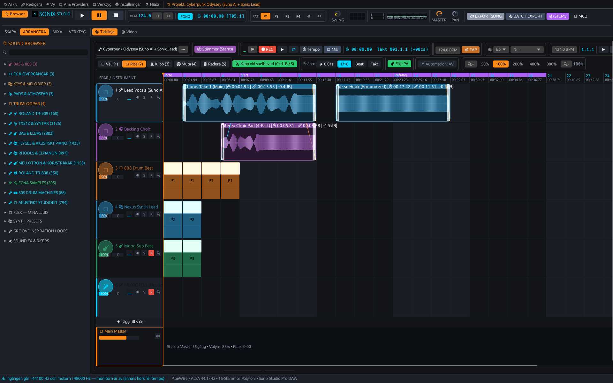

  

> **Languages:** [🇬🇧 English](README.md) · [🇸🇪 Svenska](README_SV.md) · [🇩🇰 Dansk](README_DA.md) · [🇳🇴 Norsk](README_NB.md) · [🇩🇪 Deutsch](README_DE.md) · [🇪🇸 Español](README_ES.md) · [🇫🇷 Français](README_FR.md)

# 🍊 SONIX STUDIO — professionelle Linux-DAW

Eine native Linux-DAW in **Rust** und **egui**: Kanalrack mit Drums und Synths, Pianoroll, Mixer mit
Bussen und Sends, VST3/CLAP-Hosting, Offline-Export und ein KI-Assistent, der aus einem Satz ein
Beat schreibt. Ein einziges Programm, das nur gegen glibc und `libasound` linkt.

**Die Oberfläche gibt es auf Deutsch** — außerdem auf Schwedisch, Dänisch, Norwegisch, Spanisch,
Französisch und Englisch. Umschalten live im Sprachmenü der App.

## Installation

| Distribution | Befehl |
| :--- | :--- |
| **Jede Distribution** (ohne Installation) | `chmod +x Sonix-*.AppImage && ./Sonix-*.AppImage` |
| Debian · Ubuntu · Mint · Pop! · Zorin · Kali | `sudo apt install ./sonix_<version>_amd64.deb` |
| Fedora · RHEL · Rocky · Alma · openSUSE | `sudo dnf install ./sonix-<version>-1.x86_64.rpm` |
| Arch · Omarchy · Manjaro · EndeavourOS | `yay -S sonix-bin` (AUR) |
| Alles andere | `.tar.gz` von [Releases](https://github.com/alexwest1981/sonix/releases/latest) |

Voraussetzung: x86-64 mit glibc ≥ 2.28 und ein Audioserver (PipeWire, PulseAudio oder ALSA).
ffmpeg ist optional und nur für MP3/OGG-Export nötig — WAV und FLAC funktionieren immer.

## Lizenz

GPL-3.0-only. Nutzen, bauen, ändern und weitergeben ist frei — wer eine geänderte Sonix
weitergibt, muss den Quellcode zu denselben Bedingungen veröffentlichen. Plugins sind davon nicht
betroffen: sie werden als separate Binärdateien geladen.

Die vollständige Funktionsliste, alle Screenshots und der Entwicklungsplan stehen auf
**[Englisch](README.md)**. Beiträge sind willkommen — siehe [CONTRIBUTING.md](CONTRIBUTING.md).
